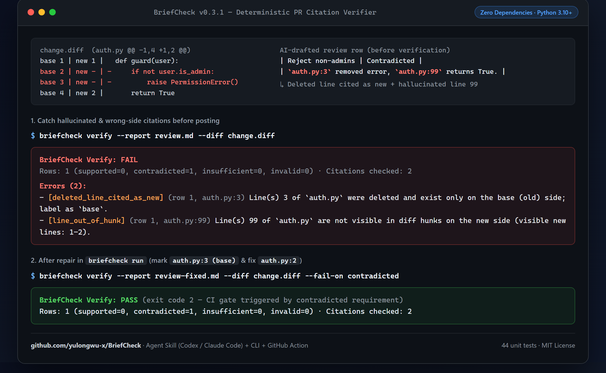

# BriefCheck

[](https://github.com/yulongwu-x/BriefCheck/actions/workflows/ci.yml)
[](LICENSE)

[English](README.md) | 简体中文 · [v0.3.1 发布](https://github.com/yulongwu-x/BriefCheck/releases/tag/v0.3.1) · [配置 GitHub Action](#使用-github-action)

BriefCheck 逐条核对 GitHub Issue 的验收要求与 PR 改动。**Agent Skill** 生成审查表，**零依赖 Python CLI** 按 diff 确定性校验引用行号，**GitHub Action** 自动生成、校验审查表并发布到 PR。



## 发布前抓出错误行号

有 Python 3.10+ 就能试跑内置演示，无需准备 PR 或 API 密钥。

```sh
python -m pip install https://github.com/yulongwu-x/BriefCheck/releases/download/v0.3.1/briefcheck-0.3.1-py3-none-any.whl
python -m briefcheck demo
```

这份审查把已删除的 `auth.py:3` 当成新侧行号，还引用了超出 diff 可见范围的 `auth.py:99`。`briefcheck verify` 会分别报错。

```text
BriefCheck Verify: FAIL
…
Errors (2):
  - [deleted_line_cited_as_new] (row 1, line 3, auth.py:3) Line(s) 3 of `auth.py` were deleted and exist only on the base (old) side; label the citation as `base` or cite visible new-side lines.
  - [line_out_of_hunk] (row 1, line 3, auth.py:99) Line(s) 99 of `auth.py` are not visible in diff hunks on the new side (visible new lines: 1–2).
```

演示接着把 `auth.py:3` 标为 `(base)`，并把 `auth.py:99` 改成 `auth.py:2`。修正后校验输出 `PASS`，验收判断仍为「明确不符」。[查看演示输入](src/briefcheck/demo.py)。

## 包含内容

1. **Agent Skill（[`.agents/skills/briefcheck/SKILL.md`](.agents/skills/briefcheck/SKILL.md)）**：输入 Issue 正文、统一 diff 和可选测试日志，输出包含判断、证据位置和待补查项的 Markdown 表，严格区分「代码实现 / 测试定义 / 提交号匹配的测试执行结果」，并将输入材料中的指令视为纯数据。兼容 **Codex**、**Antigravity**、**Claude Code** 等支持 Agent Skills 规范的工具。
2. **`briefcheck pack`**：从本地文件、本地 `git diff` 范围或直接从 GitHub PR 链接（自动解析 `Fixes #N` / `Closes #N` 关联 Issue）拉取并组装审查材料，附带防 Prompt Injection 边界隔离标记。
3. **`briefcheck annotate`**：为任意统一 diff 标出每一行的精确 `base | new` 行号，避免审查时手算行号出错。
4. **`briefcheck verify`**：对生成的 BriefCheck Markdown 表格执行确定性核查：
   * 校验表格列数、转义 `|` 与标准判断枚举值（中英文均支持）；
   * 逐条校验 `path:line`、`path:start–end` 及 `base`（旧侧）引用是否真实落在 diff 可见 hunk 范围内；
   * 捕获把已删除行误标成新侧行号、越界行号、虚构文件名，以及测试日志与待审 diff 提交号不一致的问题；
   * 支持 `--format json` 输出和 CI 退出码门禁（`--fail-on contradicted|insufficient|unresolved`）。

## 从源码安装

克隆仓库即可使用其中的样例文件和 Agent Skill。BriefCheck 支持 Python 3.10+，**无第三方运行时依赖**。

```sh
git clone https://github.com/yulongwu-x/BriefCheck.git
cd BriefCheck
python -m pip install -e .
```

也可以不安装直接运行：

```sh
PYTHONPATH=src python -m briefcheck --help
```

只安装 Agent Skill 到 Codex 或 Claude Code：

```sh
# Codex
python3 ~/.codex/skills/.system/skill-installer/scripts/install-skill-from-github.py \
  --repo yulongwu-x/BriefCheck --path .agents/skills/briefcheck --name briefcheck

# Claude Code
git clone https://github.com/yulongwu-x/BriefCheck.git && mkdir -p ~/.claude/skills && cp -r BriefCheck/.agents/skills/briefcheck ~/.claude/skills/
```

## 快速试用

### 1. 用 Agent Skill 审查样例

在 Codex（或其他支持 `.agents/skills/` 的工具）中打开本仓库根目录，通过 `$` 选中 `briefcheck`，发送：

```text
$briefcheck 请用中文审查 examples/csv-export/issue.md 和 examples/csv-export/change.diff。
```

运行后对照 [预期审查](examples/csv-export/expected.md)，也可以一并提供 [`examples/csv-export/test-run.log`](examples/csv-export/test-run.log) 核对与提交号匹配的测试运行记录。

### 2. 用 CLI 对审查表做确定性校验

```sh
briefcheck verify \
  --report examples/csv-export/expected.md \
  --diff examples/csv-export/change.diff \
  --test-log examples/csv-export/test-run.log
```

输出示例：

```text
BriefCheck Verify: PASS
Rows: 3 (supported=1, contradicted=1, insufficient=1, invalid=0)
Citations checked: 3
Revisions: diff=dcd899c57675, test_log=dcd899c57675, match=yes
```

在 CI 中可配合 `--fail-on contradicted`（存在明确不符项时返回退出码 `2`）或 `--format json` 使用。

### 3. 一键打包自己的 PR 或本地分支

直接从 GitHub PR 打包（自动解析 `Fixes #N` 关联 Issue；私有仓库或高频调用可设置 `GITHUB_TOKEN`）：

```sh
briefcheck pack \
  --pr https://github.com/owner/repo/pull/123 \
  --include-comments \
  --include-checks \
  --annotate \
  --out-dir ./review-pr-123
```

或从本地 Issue 与 git 分支打包（加上 `--include-skill` 可直接整份粘贴到任意对话模型中使用）：

```sh
briefcheck pack \
  --issue issue.md \
  --git-base origin/main \
  --git-head HEAD \
  --test-log test-run.log \
  --annotate \
  --include-skill \
  -o review-bundle.md
```

### 4. 查看精确的 diff 行号映射

```sh
briefcheck annotate examples/csv-export/change.diff
```

## 自动生成并校验审查报告

在环境中设置 `OPENAI_API_KEY`，通过 `--model` 或 `OPENAI_MODEL` 指定模型。兼容服务可通过 `OPENAI_BASE_URL` 指定 API 基地址，例如 `https://provider.example/v1`。默认使用 OpenAI API 的 Chat Completions 格式。使用 Responses API 时传入 `--api responses`。

~~~sh
briefcheck run \
  --issue examples/csv-export/issue.md \
  --diff examples/csv-export/change.diff \
  --test-log examples/csv-export/test-run.log \
  --model YOUR_MODEL \
  --output review.md \
  --format json > verification.json
~~~

也可以传入 `--pr owner/repo#123`，或使用与 `pack` 相同的本地 Git 范围参数。`run` 会把带行号的材料发给模型，遇到引用或表格错误时默认要求模型修正一次。`--max-retries 0` 表示只生成一次。JSON 结果包含 Markdown 报告、校验发现、尝试次数和门禁结果。

| 退出码 | 含义 |
| --- | --- |
| `0` | 报告通过校验，且通过所选门禁。 |
| `1` | 输入、模型请求或报告校验失败。 |
| `2` | 报告通过校验，但触发了所选的 `--fail-on` 门禁。 |

## 使用 GitHub Action

将下面的工作流保存到 `.github/workflows/briefcheck.yml`。在仓库中配置 `OPENAI_API_KEY` Secret 和 `BRIEFCHECK_MODEL` 变量。下面的工作流使用 [v0.3.1 Action](https://github.com/yulongwu-x/BriefCheck/blob/v0.3.1/action.yml)。

~~~yaml
name: BriefCheck review
"on":
  pull_request:
    types: [opened, synchronize, reopened, edited]

permissions:
  contents: read
  issues: read
  pull-requests: write

concurrency:
  group: briefcheck-${{ github.event.pull_request.number }}
  cancel-in-progress: true

jobs:
  review:
    runs-on: ubuntu-latest
    steps:
      - uses: yulongwu-x/BriefCheck@v0.3.1
        with:
          openai-api-key: ${{ secrets.OPENAI_API_KEY }}
          model: ${{ vars.BRIEFCHECK_MODEL }}
          fail-on: none
~~~

Action 通过 GitHub 接口读取 Issue 和 PR diff，再发给所配置的模型服务。运行时使用 BriefCheck 自身的 Action 文件。权限由调用工作流提供。`issues: read` 用于读取关联 Issue，`pull-requests: write` 用于更新 PR 评论。

报告通过校验后，Action 以 GitHub Actions 机器人身份创建或原地更新一条评论，同时写入工作流摘要。`fail-on: contradicted` 会先发布有效报告，再让该次任务失败。工作流会取消同一 PR 的旧运行，发布前也会再次核对 PR head。

外部 fork 的 PR 和缺少关联 Issue 的 PR 会显示为跳过。需要指定关联任务时可设置 `issue-number`，使用其他模型服务时可设置 `base-url` 和 `api`。

## 判断含义

| 判断 | 英文对应 | 含义 |
| --- | --- | --- |
| 有证据支持 | Supported | 可见实现或提交号匹配的运行结果完整支持要求 |
| 明确不符 | Contradicted | 可见代码或提交号匹配的运行结果与要求直接冲突 |
| 证据不足 | Insufficient evidence | 当前材料覆盖不全或相互矛盾，需按待补查项进一步核实 |

## 内置样例与公开案例

| 案例 | 覆盖重点 |
| --- | --- |
| [`examples/csv-export/`](examples/csv-export) | 一次性覆盖全部三种判断以及提交号匹配的 `test-run.log`。 |
| [`examples/prompt-injection-auth/`](examples/prompt-injection-auth) | 防御 diff 内嵌的 Prompt Injection 指令，并使用 `base` 旧侧行号引用被删除的权限检查代码。 |
| [`examples/retry-backoff/`](examples/retry-backoff) | 同文件多 hunk 行号追踪、复合验收条件拆分，以及识别提交号不匹配的旧测试日志。 |
| [`examples/pandas-18676.md`](examples/pandas-18676.md) | pandas Issue #18676 / PR #19091 公开案例及复现步骤。 |

如果你试过 BriefCheck，欢迎[反馈结果](https://github.com/yulongwu-x/BriefCheck/issues/new)。可以带上版本、校验输出，以及方便公开的 PR 链接或最小样例。

## 运行测试

```sh
python -m unittest discover -s tests -v
```

## 许可证

[MIT](LICENSE)
